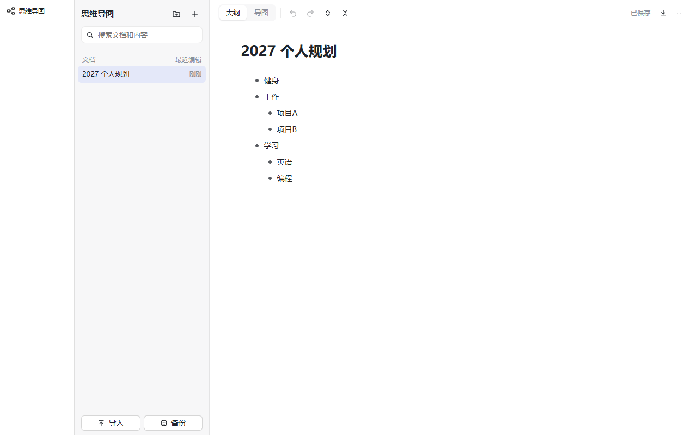
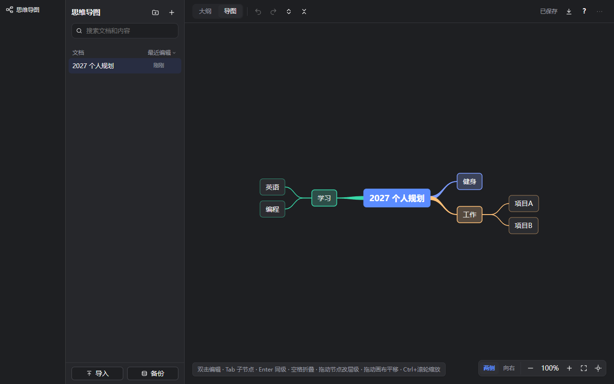

# dsh-mindmap

An **outliner and mind-map plugin** for [DeepSeek Harness](https://github.com/deepseek-ai) (DSH): write a nested outline with keyboard-first editing, switch to a live mind map of the same document, and keep everything in local files with autosave and backups.

**Zero configuration**: install and open 思维导图 in the sidebar. No account, token or extra service required.

[简体中文](README.zh-CN.md)

| Outline | Mind map (dark) |
|---|---|
|  |  |

## Features

- **Outline** — unlimited levels; Enter splits/creates a sibling, Alt+Enter inserts a line break, Shift+Enter adds a note, Tab / Shift+Tab indent / outdent, Backspace deletes an empty node or merges with the previous one, Delete merges the next one, ↑/↓ move across nodes, Alt+↑/↓ move a node, Ctrl+. collapse, Ctrl+Enter toggle done, Alt+→ focus a subtree (breadcrumb to go back), Ctrl+Z / Ctrl+Shift+Z / Ctrl+Y undo/redo. Drag the bullet to reorder or change level. Multi-line paste becomes a tree. Inline Markdown (bold, italic, strikethrough, code, links, #tags) and checkboxes. Find and replace (Ctrl+F), #tag filter, Esc selects rows for batch indent / move / delete / copy. Press Ctrl+/ for all shortcuts. IME composition is never intercepted.
- **Mind map** — two-sided or right-only tree with coloured branches, collapse/expand, Ctrl+wheel zoom (20%–300%), drag to pan, center / fit / 100%, double-click or F2 to edit, Tab adds a child, Enter adds a sibling, arrows move between nodes, drag a node to reparent it.
- **Documents** — create, rename, trash and restore, nested folders with drag and drop, favorites (Alt+1…9), sorting, last-edited time, search across titles, node text and notes; trash is emptied automatically after 30 days.
- **Import / export** — import Markdown and OPML; export Markdown, OPML, PNG and SVG (whole document or the focused subtree).
- **Storage** — autosave 800 ms after typing stops and immediately on document switch / page hide; atomic writes; revision-based conflict detection; daily automatic backups (14 kept), manual backup, download and atomic restore; edits in another tab are picked up automatically.

## Requirements

- DSH `>=0.2.2-rc.1 <0.3.0` (declared in `engines.dsh`; DSH checks it at install and at profile start)
- The web GUI (the page is a web client plugin)

## Install

Replace `desktop` with your profile name. `dsh plugin --profile <name> ...` forwards the arguments to pnpm inside that profile.

From npm (published as the scoped package `@huoweifang/dsh-mindmap`; the plugin itself is named `dsh-mindmap`):

```sh
dsh plugin --profile desktop add @huoweifang/dsh-mindmap
```

From GitHub (pin a tag; `lib/` is committed, so no build step runs on install):

```sh
dsh plugin --profile desktop add github:IsaacHuo/dsh-mindmap#v0.2.1
```

Restart DSH. A **思维导图** entry appears in the sidebar.

### Update

```sh
dsh plugin --profile desktop add @huoweifang/dsh-mindmap@latest          # npm
dsh plugin --profile desktop add github:IsaacHuo/dsh-mindmap#v0.2.1   # GitHub
```

npm installs can also be updated from the DSH plugin manager. Restart DSH afterwards.

### Uninstall

```sh
dsh plugin --profile desktop remove @huoweifang/dsh-mindmap
```

Uninstalling keeps your documents. Delete the data directory below by hand if you want them gone.

## Data and security

- Data directory: `~/.dsh/dsh-mindmap/` (or `$DSH_HOME/dsh-mindmap`; override with `DSH_MINDMAP_DIR`). It holds `library.json`, `docs/<id>.json` and `backups/`.
- Documents are plain, unencrypted JSON. Anyone with access to your user account can read them; don't store secrets.
- The plugin only registers HTTP routes under `/dsh-mindmap/api` on the DSH web server and inherits its access control. Write requests must be `application/json` (blocks simple cross-site form posts); requests must come from a loopback host with a same-origin `Origin`; bodies are capped per route (save 32 MB, restore 64 MB, others 1 MB); document ids are validated before touching the file system.
- No network requests, telemetry, agent tools or model calls. Links in notes open only for `http(s)` URLs, and notes are never rendered as HTML.

## Development

```sh
npm ci
npm run typecheck   # tsc --noEmit
npm test            # unit tests (node:test)
npm run build       # lib/index.js (host) + lib/client.js (web page)
npm run pack:check  # verify the npm tarball contents
npm run harness     # local test page: real host routes + mocked DSH slots
npm run e2e         # headless end-to-end test (Chromium/Edge via EDGE_PATH)
```

To try a working copy in DSH: `dsh plugin --profile <name> add link:<path-to-this-repo>`.

The client does not bundle React — the DSH page provides it. `lib/` is committed so GitHub installs work; CI fails if it is out of date, so run `npm run build` before committing.

## Release

1. Update `version` in `package.json` and `CHANGELOG.md`, run `npm run check`, commit.
2. `git tag v<version> && git push origin v<version>`.
3. The Release workflow checks the tag against `package.json`, rebuilds, publishes to npm with provenance (`next` tag for prereleases) and creates a GitHub Release with the tarball. It needs the `NPM_TOKEN` repository secret.

## License

[MIT](LICENSE). Not affiliated with DeepSeek or any outliner product; no third-party brand assets are included.
