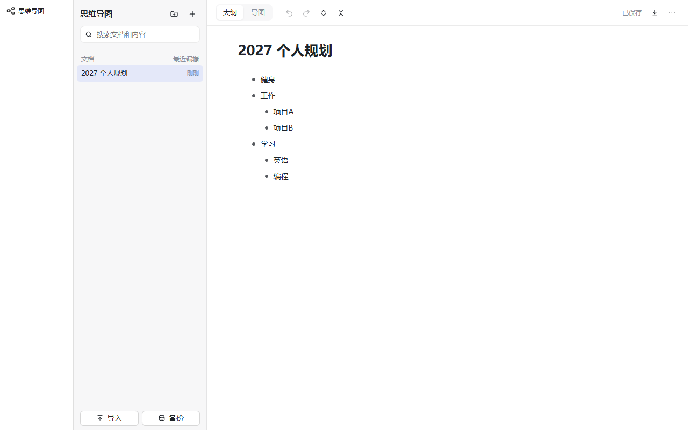
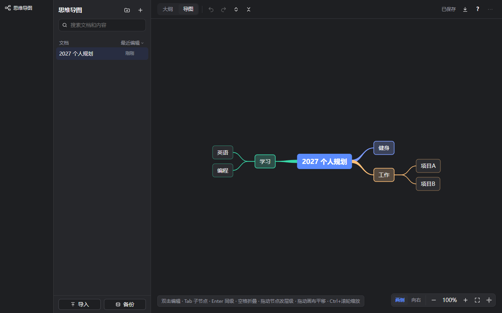

# dsh-mindmap（思维导图）

[DeepSeek Harness](https://github.com/deepseek-ai)（DSH）的**大纲笔记与思维导图插件**：用键盘快速写多级大纲，一键切换为同一份文档的实时思维导图，数据以本地文件保存，自动保存并定期备份。

**零配置**：安装后在侧边栏打开「思维导图」即可使用，无需账号、Token 或额外服务。

[English](README.md)

| 大纲 | 导图（深色） |
|---|---|
|  |  |

## 功能

- **大纲**：无限层级；Enter 拆分 / 新建同级，Alt+Enter 换行，Shift+Enter 添加备注，Tab / Shift+Tab 缩进 / 反缩进，Backspace 删除空节点或与上一行合并，Delete 合并下一行，↑/↓ 跨节点移动，Alt+↑/↓ 移动节点，Ctrl+. 折叠，Ctrl+Enter 完成，Alt+→ 聚焦子树（面包屑返回），Ctrl+Z / Ctrl+Shift+Z / Ctrl+Y 撤销重做；拖动圆点调整顺序或层级；多行粘贴自动生成层级；行内 Markdown（粗体、斜体、删除线、代码、链接、#标签）与复选框；查找替换（Ctrl+F）、#标签筛选，Esc 进入行选择后可批量缩进 / 移动 / 删除 / 复制；Ctrl+/ 查看全部快捷键；输入法组字期间不拦截按键。
- **导图**：向右（默认）或两侧布局、分支配色、折叠 / 展开、Ctrl+滚轮缩放（20%–300%）、拖动平移、居中 / 适应窗口 / 100%；双击或 F2 编辑，Tab 加子节点，Enter 加同级，方向键切换节点，拖动节点改变父级。
- **文档管理**：新建、重命名、删除到回收站并可恢复、多级文件夹与拖放、收藏（Alt+1…9）、排序、最近编辑时间、搜索标题 / 节点 / 备注；回收站 30 天后自动清空。
- **导入导出**：导入 Markdown、OPML；导出 Markdown、OPML、PNG、SVG（整篇或聚焦的子树）。
- **存储**：停止输入 800 ms 后自动保存，切换文档 / 离开页面时立即保存；原子写入；修订号冲突检测；每日自动备份（保留 14 份），可手动备份、下载、原子恢复；其他标签页的修改会自动同步。

## 环境要求

- DSH `>=0.2.2-rc.1 <0.3.0`（声明在 `engines.dsh`，DSH 在安装和启动 profile 时检查）
- 使用 Web 界面（页面是 Web 客户端插件）

## 安装

把 `desktop` 换成你的 profile 名。`dsh plugin --profile <名称> ...` 会把参数转给该 profile 内的 pnpm。

从 npm 安装（npm 包名为 `@huoweifang/dsh-mindmap`，插件本身名为 `dsh-mindmap`）：

```sh
dsh plugin --profile desktop add @huoweifang/dsh-mindmap
```

从 GitHub 安装（固定到 tag；仓库提交了 `lib/`，安装时不需要构建）：

```sh
dsh plugin --profile desktop add github:IsaacHuo/dsh-mindmap#v0.2.1
```

重启 DSH，侧边栏出现「思维导图」。

### 更新

```sh
dsh plugin --profile desktop add @huoweifang/dsh-mindmap@latest          # npm
dsh plugin --profile desktop add github:IsaacHuo/dsh-mindmap#v0.2.1   # GitHub
```

npm 安装的版本也可以在 DSH 插件管理里更新。更新后重启 DSH。

### 卸载

```sh
dsh plugin --profile desktop remove @huoweifang/dsh-mindmap
```

卸载不会删除文档；如需彻底清除，手动删除下面的数据目录。

## 数据与安全

- 数据目录：`~/.dsh/dsh-mindmap/`（或 `$DSH_HOME/dsh-mindmap`，可用 `DSH_MINDMAP_DIR` 覆盖），包含 `library.json`、`docs/<id>.json`、`backups/`。
- 文档是未加密的 JSON 文件，能访问你系统账号的人都能读到，请勿存放机密。
- 插件只在 DSH Web 服务上注册 `/dsh-mindmap/api` 路由，沿用 DSH 自身的访问控制；写请求必须是 `application/json`（挡住简单的跨站表单提交），请求须来自回环地址且 `Origin` 同源，请求体按路由限制（保存 32 MB、恢复 64 MB、其他 1 MB），文档 id 在访问文件系统前校验。
- 不发起网络请求、无遥测、不注册 Agent 工具、不调用模型。笔记中的链接只允许 `http(s)`，笔记内容从不作为 HTML 渲染。

## 开发

```sh
npm ci
npm run typecheck   # tsc --noEmit
npm test            # 单元测试（node:test）
npm run build       # lib/index.js（宿主）+ lib/client.js（页面）
npm run pack:check  # 检查 npm 包内容
npm run harness     # 本地测试页：真实宿主路由 + 模拟 DSH 插槽
npm run e2e         # 无头端到端测试（Chromium/Edge，路径用 EDGE_PATH 指定）
```

在 DSH 里试用工作副本：`dsh plugin --profile <名称> add link:<本仓库路径>`。

客户端不打包 React，由 DSH 页面提供。`lib/` 随仓库提交以支持 GitHub 安装；CI 会检查它是否与源码一致，提交前请先 `npm run build`。

## 发布

1. 修改 `package.json` 的 `version` 和 `CHANGELOG.md`，运行 `npm run check` 后提交。
2. `git tag v<版本> && git push origin v<版本>`。
3. Release 工作流校验 tag 与 `package.json` 一致，重新构建，带 provenance 发布到 npm（预发布版用 `next` 标签），并创建附带 tarball 的 GitHub Release。需要仓库 secret `NPM_TOKEN`。

## 许可证

[MIT](LICENSE)。与 DeepSeek 及任何大纲笔记产品无隶属关系，不含第三方品牌素材。
